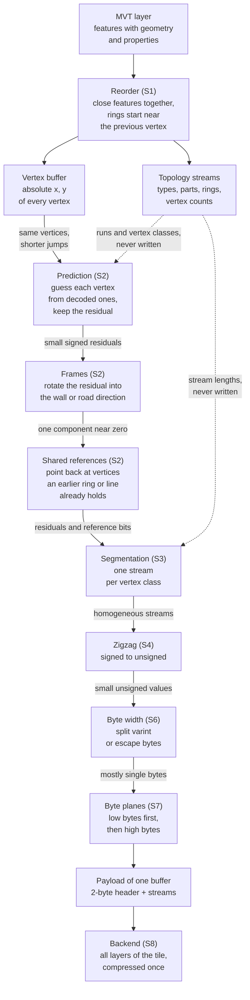
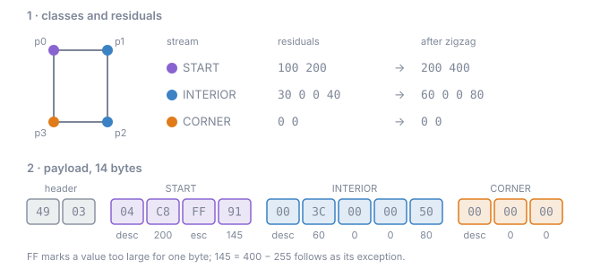

# The vertex-buffer pipeline

These pages explain how the thesis encodes the geometry of a MapLibre Tile (MLT). Every layer of a tile
stores the coordinates of its vertices in a `VertexBuffer`. Stock MLT writes it as the difference between
consecutive vertices, packed by a generic integer codec. The pipeline replaces this with a chain of small,
reversible stages. Each stage exploits one property of map geometry (features close together, right-angled
buildings, straight roads, shared walls and junctions), and every stage is built to feed the
general-purpose compressor (gzip, Brotli or zstd) that the tile is delivered with.

## Gains against stock MLT v2

The pipeline runs inside the MLT v2 encoder (`mlt-core`, Rust) as its vertex encoder. Everything else in
the tile (topology, ids, property columns) is written by the stock encoder. The sizes are whole tiles as a
client receives them: the Munich corpus, 358 tiles, every layer, gzip level 6, summed over all tiles.

| encoder | raw bytes | gzip bytes | gzip vs stock |
|---|---|---|---|
| stock MLT v2 | 18.487.134 | 16.786.524 | |
| stock MLT v2 with its own feature sorting | 18.317.963 | 16.643.440 | -0,85% |
| pipeline, plain delta + split varint on every layer | 19.383.707 | 16.202.284 | -3,48% |
| pipeline, per-layer default composition | 19.186.915 | 15.785.075 | -5,97% |
| pipeline, `DEFAULT` composition on every layer | 19.338.509 | 15.534.092 | -7,46% |
| pipeline, tile oracle without feature reorder | 18.767.109 | 15.298.529 | -8,86% |
| pipeline, tile oracle | 18.702.304 | 15.234.332 | -9,25% |

The tile oracle saves 1,55 MB of 16,79 MB. Three things stand out:

- The pipeline's tiles are larger before compression and smaller after it. The stages make the bytes
  easy to compress, not small on their own.
- About a third of the gain (3,48 points) comes from writing the vertices in a gzip-friendly form at all.
  The predictors, frames, references and stream layouts add 5,6 points, the feature reorder 0,4.
- All 358 tiles decode, and every feature keeps its shape. What may change is what a renderer does not
  draw differently: feature order, the start vertex of a ring, the order of points in a MultiPoint, and the
  direction of some line parts (which matters only for direction-dependent symbols such as one-way arrows).

The gain sits where the geometry has structure. Each layer compressed on its own:

| layer | stock MLT v2 | tile oracle | change |
|---|---|---|---|
| building | 4.287.027 | 3.483.636 | -18,74% |
| transportation | 3.608.695 | 3.199.356 | -11,34% |
| poi | 3.035.607 | 3.058.335 | +0,75% |
| landcover | 1.748.145 | 1.512.044 | -13,51% |
| housenumber | 1.239.693 | 1.262.033 | +1,80% |
| transportation_name | 892.802 | 838.878 | -6,04% |
| landuse | 876.416 | 794.569 | -9,34% |
| all 16 layers | 17.064.891 | 15.481.020 | -9,28% |

Buildings gain most from corner guesses, wall frames and shared walls, landcover from shared borders, roads
from continuation and junctions. Point layers have no shape to exploit and end slightly above stock.

Full results, by zoom and by layer:
[mlt-v2-rust-port.md](https://github.com/Turtelll/Thesis/blob/main/research-java/docs/results/mlt-v2-rust-port.md).

## How the encoding builds on itself

Each stage takes the output of the stage before it and makes it easier for the next one. The topology
streams, which stock MLT writes and the decoder reads first, run alongside: the stages derive everything
structural from them, so none of it is written into the vertex payload.



The same build-up in numbers: the research harness adds one decision at a time and measures the vertex
buffers of all tiles under gzip, against plain delta + zigzag + varint, the smaller of the two stock
baselines (11.237.124 bytes).

| step | gzip bytes | vs baseline | this step |
|---|---|---|---|
| plain delta + zigzag + varint, plus the 2-byte header | 11.243.566 | +0,06% | |
| split varint instead of varint | 11.146.031 | -0,81% | -0,87% |
| + Hilbert reorder (S1) | 10.781.955 | -4,05% | -3,27% |
| + corner guess, ring frame and shared references (S2) | 10.292.463 | -8,41% | -4,54% |
| + class streams (S3) | 10.183.793 | -9,37% | -1,06% |
| + escape width (S6) | 10.176.922 | -9,43% | -0,07% |
| + byte planes (S7) | 10.118.776 | -9,95% | -0,57% |
| reorder removed again: `DEFAULT` | 10.450.157 | -7,00% | +3,27% |

Prediction is the largest step. The escape width alone gains almost nothing; it is there because the byte
planes after it need a fixed width. The reorder looks large on the geometry, but it permutes the property
columns too and costs more there than it saves here, so `DEFAULT` drops it again. Choosing the composition
per layer or per tile instead of one for everything takes the vertex buffers further, to -11,36% and
-11,94% ([compositions](pipeline/01-composition.md)).

```
./gradlew research --args="measure --step ladder --by-zoom"
```

## How a composition is chosen

Every stage has a few options, and a composition is one choice per stage. The decoder reads all choices but
the reorder from the two header bytes of each buffer, and the reorder needs nothing undone, so how a
composition was chosen never matters to the decoder. Today there are three ways to choose:

- the per-layer default, one fixed composition per MVT layer, fitted once on the corpus;
- the tile oracle, which tries 96 compositions on every layer of every tile and keeps the combination that
  makes the whole gzipped tile smallest;
- one fixed composition for every layer.

The [compositions](pipeline/01-composition.md) page explains each, with the search loop of the tile oracle.

## Rules every stage follows

- Nothing derivable is written. The decoder reads the topology before the vertex buffer, and from it
  derives the runs (one per ring or line part), the class of every vertex and the length of every stream. Only two lengths are ever
  written: the byte length of a varint stream that is not the last one, and the stream lengths of a buffer
  with shared references.
- Lossless. Every composition round-trips every buffer, checked by the harness and by the test suite. The
  only freedoms used are the ones a renderer cannot see: feature order, ring start, MultiPoint order, and
  the direction of line parts reversed by the shared line references.
- Self-describing. Every choice except the reorder is in the two header bytes, so a buffer decodes from its
  bytes and the topology alone.

## One buffer, end to end

A rectangular building, first in its buffer (so the previous vertex is the origin), with the composition:
no reorder, `QUAD_CORNER`, class streams, zigzag, escape width, byte planes.

```
vertices        p0=(100,200)  p1=(130,200)  p2=(130,240)  p3=(100,240)
class           START         INTERIOR      INTERIOR      CORNER
guess           (0,0)         p0            p1            p0 + p2 - p1 = (100,240)
residual        (100,200)     (30,0)        (0,40)        (0,0)

streams         START: 100 200 | INTERIOR: 30 0 0 40 | CORNER: 0 0
zigzag          START: 200 400 | INTERIOR: 60 0 0 80 | CORNER: 0 0
bytes           START:    04 C8 FF 91      descriptor (1-byte values, escape, 1-byte exceptions), 200, marker, 400-255
                INTERIOR: 00 3C 00 00 50   descriptor (1-byte values), values
                CORNER:   00 00 00
header          49 03
payload         49 03 04 C8 FF 91 00 3C 00 00 50 00 00 00   (14 bytes)
```

The decoder reads the header, derives from the topology that the ring has four vertices (classes
`START INTERIOR INTERIOR CORNER`, so 2 + 4 + 2 values), reads the three streams, undoes zigzag and walks the
vertices, adding each residual to the same guess.



## The pages

1. [Compositions](pipeline/01-composition.md): what a composition is and how one is chosen.
2. [Reorder](pipeline/02-reorder.md): emit close features next to each other.
3. [Prediction](pipeline/03-prediction.md): guess each vertex from the ones before it.
4. [Frames](pipeline/04-frames.md): write residuals in the direction of the wall or road.
5. [Shared references](pipeline/05-shared-references.md): point back at repeated vertices.
6. [Segmentation](pipeline/06-segmentation.md): one stream per kind of residual.
7. [Zigzag and byte width](pipeline/07-byte-width.md): from residuals to bytes.
8. [Byte planes](pipeline/08-transpose.md): group the bytes of fixed-width values.
9. [Backend](pipeline/09-backend.md): the compressor and how sizes are measured.

The stage numbers S1 to S8 are the order in which the stages were built and measured. S5, dividing a stream
by the greatest common divisor of its values, fired on 0,02% of the values and was removed; the later
numbers were kept. The byte-level format is in
[bitstream.md](https://github.com/Turtelll/Thesis/blob/main/research-java/docs/bitstream.md), the code in
`research-java/src/main/java/org/maplibre/mlt/research/encoder/`, one package per stage.
