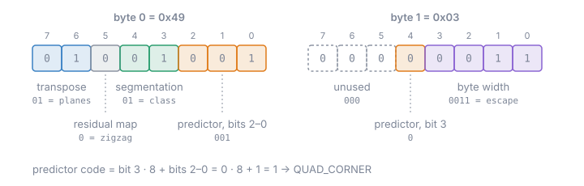
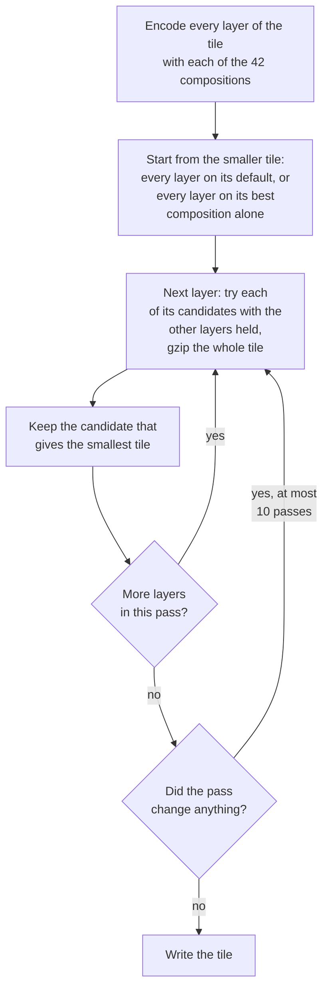

# 1. Compositions: how the stages are chosen

## The idea

Every stage of the pipeline offers a few options, and none of them is best everywhere. Corner guesses suit
buildings, continuation suits roads, plain delta suits points. Class streams help large polygon buffers and
hurt small line buffers. A reorder shrinks the geometry but can grow the property columns. Rather than
fixing one option per stage, the pipeline picks one per stage for each layer. That set of choices is a
composition.

## What a composition is

A composition is one choice per stage (`research-rust/mlt-pipeline/src/format.rs`):

```rust
struct Composition { reorder: Reorder, predictor: Prediction, segmentation: Segmentation, terminal: Terminal }
```

The residual map is always zigzag and the terminal always escape width with byte planes, so the name lists
them but there is nothing to choose. The name is built from the choices, so it always says what it does:

```
PIPE_HILBERT_CENTROID_ROT_MP_QUAD_CORNER_SHARED_RAW_PREVFRAME_FIRST_ONLY_CLASS_ZIGZAG_ESCAPE_PLANES

reorder        HILBERT_CENTROID_ROT_MP
predictor      QUAD_CORNER_SHARED_RAW_PREVFRAME_FIRST_ONLY
segmentation   CLASS
map            ZIGZAG
terminal       ESCAPE_PLANES
```

This one reads: Hilbert order with ring rotation and sorted MultiPoints, the corner guess with ring frame
and shared references, class streams, zigzag, escape width, byte planes. A choice of `NONE` leaves its part
out of the name.

The decoder never needs to know how a composition was chosen. Every choice but the reorder is written in the
two header bytes of every buffer, and the reorder needs nothing undone. Any way of choosing therefore
produces tiles that decode the same way.

| byte | bits | field |
|---|---|---|
| 0 | 0-2 | predictor code, low 3 bits |
| 0 | 3-4 | segmentation |
| 0 | 5 | residual map |
| 0 | 6-7 | transpose |
| 1 | 0-3 | byte width |
| 1 | 4-7 | predictor code, high bits |



## The options to choose from

Only options that won their stage remain, which leaves 42 compositions (`best_grid()` in
`research-rust/mlt-pipeline/src/registry.rs`):

- 3 reorders: none, Hilbert, chain;
- 7 predictors (the table on the [prediction](03-prediction.md) page);
- 2 segmentations: flat or class streams.


## How a composition is chosen today

There are three ways, from cheapest to smallest. In the `mlt` command line tool they are the values of one
flag:

```
mlt convert in.mbtiles out.mbtiles --mlt-version 2 --vertex-pipeline default --verify   # per-layer default
mlt convert in.mbtiles out.mbtiles --mlt-version 2 --vertex-pipeline oracle --verify    # tile oracle
mlt convert in.mbtiles out.mbtiles --mlt-version 2 --vertex-pipeline <NAME> --verify    # one composition for every layer
```

### 1. The per-layer default

`for_layer(layer)` (`registry.rs`) holds one fixed composition per MVT layer. Encoding costs one pass per
layer, and nothing is searched at runtime. A layer it does not know gets `DEFAULT`: no reorder,
`QUAD_CORNER_SHARED_RAW_PREVFRAME_FIRST_ONLY`, class streams.

| layer | reorder | predictor | streams |
|---|---|---|---|
| building, landcover, landuse | Hilbert | `QUAD_CORNER_SHARED_RAW_PREVFRAME_FIRST_ONLY` | class |
| water | chain | `QUAD_CORNER_SHARED_RAW_PREVFRAME_FIRST_ONLY` | class |
| aeroway | chain | `QUAD_CORNER_SHARED_RAW_PREVFRAME_FIRST_ONLY` | flat |
| park | Hilbert | `QUAD_CORNER_SHARED_RAW` | flat |
| place | Hilbert | `QUAD_CORNER_PREVFRAME_FIRST_ONLY` | flat |
| transportation | chain | `LINE_CONTINUATION_SHARED` | class |
| transportation_name, waterway | chain | `LINE_CONTINUATION_SHARED` | flat |
| boundary | Hilbert | `LINE_CONTINUATION_SHARED` | flat |
| mountain_peak, water_name, housenumber | Hilbert | `LINE_CONTINUATION` | flat |
| poi | Hilbert | `DELTA` | class |
| aerodrome_label | Hilbert | `DELTA` | flat |

The table follows the geometry: shared corner predictors on polygons, continuation on lines, delta on
points. It was fitted on the vertex buffers alone of an earlier, larger grid and is not re-fitted: where the
fit chose an option the grid no longer has, the table holds its nearest kept one (a line predictor with
frame became the same predictor without frame, split varint became escape with byte planes). It reorders every layer, so it does
not see what the reorder costs the property columns (see `poi` below).

### 2. The tile oracle

The tile oracle chooses a composition for every layer of every tile by trying them on the tile itself
(`research-rust/mlt-tile-oracle`):



Each candidate is a complete layer encoding: the reorder permutes whole features, with their ids and
property columns, so the size the oracle minimises is the size of the real tile. Every candidate also picks
the encodings of its other streams (ids, geometry lengths, properties) by gzip size instead of raw size. The
search is a coordinate descent and finds a local optimum, never larger than either starting tile. It is
expensive: 42 encodes per layer and many gzip trials per tile, 338 seconds for the 358 tiles of the
corpus against 4 seconds for the per-layer default.

### 3. One composition for every layer

`--vertex-pipeline <NAME>` writes every layer with the same composition.

## Why choose on the whole tile

- Choosing per buffer, each buffer compressed alone, over-selects. A tile is compressed as one piece, and
  buffers written in different formats share fewer matches in the compressor's window. An early per-buffer
  selector was smaller in isolation and larger on the delivered tiles than one fixed composition.
- The search measures gzip, not raw size. Choosing by raw bytes or by entropy estimates picks worse
  compositions (-9,19% against -11,94% on the geometry buffers).
- Only whole-layer candidates see the property columns. `poi` with its per-layer default (Hilbert order) is
  12,37% larger than stock MLT v2; the tile oracle ends 1,14% below stock.

## What each way gives

Whole MLT v2 tiles, gzip, against stock MLT v2 (16.786.524 bytes), `mlt convert` on 358 tiles:

| composition | gzip | vs stock | encode time | decode (× stock) |
|---|---|---|---|---|
| per-layer default | 15.836.613 | -5,66% | 4 s | 2,57 to 2,60 |
| tile oracle (with gzip stream choice) | 15.173.753 | -9,61% | 338 s | 2,33 to 2,35 |

Decode is whole-tile, single-threaded, decompression not timed (`mlt-oracle decode-time`, three runs, stock 112
to 119 ms for the 358 tiles on a machine that was not idle; only the ratios are comparable).

What the tile oracle picks on whole tiles (share of the 4.368 layers; counted with the earlier entry index,
codes 7 and 25 in the slots of 26 and 27, not recounted):

| stage | picks |
|---|---|
| reorder | none 72,6%, Hilbert 21,9%, chain 5,5% |
| predictor | `DELTA` 34,7%, `LINE_CONTINUATION_SHARED` 15,9%, `QUAD_CORNER_SHARED_PREVFRAME_FIRST_ONLY` (now 27) 13,1%, `QUAD_CORNER` 12,7%, `LINE_CONTINUATION` 9,4%, `QUAD_CORNER_PREVFRAME_FIRST_ONLY` 7,4%, `QUAD_CORNER_SHARED` (now 26) 6,9% |
| streams | class 58,7%, flat 41,3% |

No composition dominates: the most frequent, `PIPE_DELTA_FLAT_ZIGZAG_ESCAPE_PLANES`, is picked on 24,2% of
the layers.

In the code: `research-rust/mlt-pipeline/src/registry.rs`, `research-rust/mlt-tile-oracle/src/lib.rs`.

Further reading: [per-layer composition](../encoding/good/per-layer-composition.md),
[per-buffer selection](../encoding/bad/per-buffer-selection.md),
[raw-size search](../encoding/bad/search-on-raw-size.md),
[MLT v2 results](https://github.com/Turtelll/Thesis/blob/main/research-java/docs/results/mlt-v2-rust-port.md).
