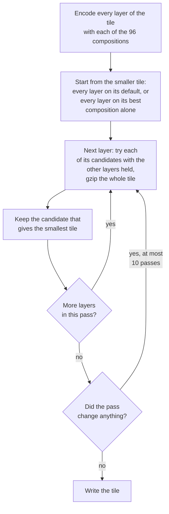

# 2. Compositions: how the stages are chosen

## The idea

Every stage of the pipeline offers a few options, and none of them is best everywhere. Corner guesses suit
buildings, continuation suits roads, plain delta suits points. Class streams help large polygon buffers and
hurt small line buffers. A reorder shrinks the geometry but can grow the property columns. Rather than
fixing one option per stage, the pipeline picks one per stage for each layer. That set of choices is a
composition.

## What a composition is

A composition is one choice per stage (`encoder/format/Composition.java`):

```java
record Composition(Reorder reorder, Prediction predictor, Segmentation segmentation,
                   ResidualMap map, ByteWidth width, Transpose transpose)
```

Its name is built from the choices, so it always says what it does:

```
PIPE_HILBERT_CENTROID_ROT_MP_QUAD_CORNER_SHARED_FRAME_CLASS_ZIGZAG_ESCAPE_PLANES

reorder        HILBERT_CENTROID_ROT_MP
predictor      QUAD_CORNER_SHARED_FRAME
segmentation   CLASS
map            ZIGZAG
width          ESCAPE
transpose      PLANES
```

This one reads: Hilbert order with ring rotation and sorted MultiPoints, the corner guess with ring frame
and shared references, class streams, zigzag, escape width, byte planes. A choice of `NONE` leaves its part
out of the name.

The decoder never needs to know how a composition was chosen. Five of the six choices are written in the
two header bytes of every buffer, and the sixth, the reorder, needs nothing undone. Any way of choosing
therefore produces tiles that decode the same way.

| byte | bits | field |
|---|---|---|
| 0 | 0-2 | predictor code, low 3 bits |
| 0 | 3-4 | segmentation |
| 0 | 5 | residual map |
| 0 | 6-7 | transpose |
| 1 | 0-3 | byte width |
| 1 | 4 | predictor code, bit 3 |
| 1 | 5-7 | unused |

## The options to choose from

Only options that won their stage remain, which leaves 96 compositions (`CompositionGrids.bestGrid()`):

- 3 reorders: none, Hilbert, chain;
- 8 predictors (the table on the [prediction](04-prediction.md) page);
- 2 segmentations: flat or class streams;
- 2 byte layouts: split varint, or escape width with byte planes.

The residual map is always zigzag, and the transpose follows the width, since only a fixed width can be
split into planes.

## How a composition is chosen today

There are three ways, from cheapest to smallest. In the `mlt` command line tool they are the values of one
flag:

```
mlt convert in.mbtiles out.mbtiles --mlt-version 2 --vertex-pipeline default --verify   # per-layer default
mlt convert in.mbtiles out.mbtiles --mlt-version 2 --vertex-pipeline oracle --verify    # tile oracle
mlt convert in.mbtiles out.mbtiles --mlt-version 2 --vertex-pipeline <NAME> --verify    # one composition for every layer
```

### 1. The per-layer default

`LayerCompositions.forLayer(layer)` holds one fixed composition per MVT layer. It was fitted once on the
Munich corpus: for each layer, the composition (with Hilbert or chain order) whose buffers of that layer add
up to the fewest gzip bytes. Encoding costs one pass per layer, and nothing is searched at runtime. A layer
the fit has not seen gets `DEFAULT`: no reorder, `QUAD_CORNER_SHARED_FRAME`, class streams, escape with
byte planes.

| layer | reorder | predictor | streams | bytes |
|---|---|---|---|---|
| building, landcover, landuse | Hilbert | `QUAD_CORNER_SHARED_FRAME` | class | escape + planes |
| water | chain | `QUAD_CORNER_SHARED_FRAME` | class | escape + planes |
| aeroway | chain | `QUAD_CORNER_SHARED_FRAME` | flat | split varint |
| park | Hilbert | `QUAD_CORNER_SHARED` | flat | split varint |
| place | Hilbert | `QUAD_CORNER_FRAME` | flat | split varint |
| transportation | chain | `LINE_CONTINUATION_SHARED_FRAME_HEADING` | class | escape + planes |
| transportation_name, waterway | chain | `LINE_CONTINUATION_SHARED_FRAME_HEADING` | flat | split varint |
| boundary | Hilbert | `LINE_CONTINUATION_SHARED_FRAME_HEADING` | flat | split varint |
| mountain_peak | Hilbert | `LINE_CONTINUATION_FRAME_HEADING` | flat | split varint |
| water_name | Hilbert | `LINE_CONTINUATION` | flat | split varint |
| housenumber | Hilbert | `LINE_CONTINUATION` | flat | escape + planes |
| poi | Hilbert | `DELTA` | class | escape + planes |
| aerodrome_label | Hilbert | `DELTA` | flat | split varint |

The table follows the geometry: shared corner predictors on polygons, continuation on lines, delta on
points. Its weakness is that it was fitted on the vertex buffers alone and reorders every layer, so it does
not see what the reorder costs the property columns (see `poi` below).

### 2. The tile oracle

The tile oracle chooses a composition for every layer of every tile by trying them on the tile itself
(`research-rust/mlt-tile-oracle`, a port of the Java `TileSelector`):



Each candidate is a complete layer encoding: the reorder permutes whole features, with their ids and
property columns, so the size the oracle minimises is the size of the real tile. The search is a
coordinate descent and finds a local optimum, never larger than either starting tile. It is expensive:
96 encodes per layer and many gzip trials per tile, 697 seconds for the 358 tiles of the corpus against 9
seconds for the per-layer default.

### 3. One composition for every layer

`--vertex-pipeline <NAME>` writes every layer with the same composition. With `DEFAULT`
(`PIPE_QUAD_CORNER_SHARED_FRAME_CLASS_ZIGZAG_ESCAPE_PLANES`, no reorder) this already beats the per-layer
default on whole tiles, because it leaves the property columns in their original order.

## Why choose on the whole tile

- Choosing per buffer, each buffer compressed alone, over-selects. A tile is compressed as one piece, and
  buffers written in different formats share fewer matches in the compressor's window. An early per-buffer
  selector was smaller in isolation and larger on the delivered tiles than one fixed composition.
- The search measures gzip, not raw size. Choosing by raw bytes or by entropy estimates picks worse
  compositions (-9,19% against -11,94% on the geometry buffers).
- Only whole-layer candidates see the property columns. `poi` with its per-layer default (Hilbert order) is
  12,4% larger than stock MLT v2; the oracle mostly keeps its original order and ends 0,75% above stock.

## What each way gives

Whole MLT v2 tiles, gzip, against stock MLT v2 (16.786.524 bytes):

| composition | gzip | vs stock | encode time |
|---|---|---|---|
| per-layer default | 15.785.075 | -5,97% | 9 s |
| `DEFAULT` for every layer | 15.534.092 | -7,46% | 9 s |
| tile oracle | 15.234.332 | -9,25% | 697 s |

On the vertex buffers alone (Java harness, gzip, against plain delta + varint), where the property columns
do not count, the order is different: `DEFAULT` -7,00%, the best single composition -9,95%, the per-layer
default -11,36%, the tile oracle -11,94%. The per-layer default is well fitted for geometry; on whole tiles
its reorders cost more than they save.

What the tile oracle picks on whole tiles (share of the 4.368 layers):

| stage | picks |
|---|---|
| reorder | none 71,9%, Hilbert 22,2%, chain 5,8% |
| predictor | `DELTA` 34,2%, `QUAD_CORNER_SHARED_FRAME` 16,1%, `LINE_CONTINUATION_SHARED_FRAME_HEADING` 16,1%, `QUAD_CORNER` 9,8%, `QUAD_CORNER_FRAME` 8,5%, `LINE_CONTINUATION_FRAME_HEADING` 6,5%, `LINE_CONTINUATION` 4,9%, `QUAD_CORNER_SHARED` 3,8% |
| streams | flat 55,8%, class 44,2% |
| bytes | split varint 53,0%, escape + planes 47,0% |

No composition dominates. Plain `DELTA` is the most frequent pick, but on small buffers: in the Java search
it holds 12,5% of the chosen bytes, while the two shared predictors hold about two thirds.

In the code: `registry/LayerCompositions.java`, `registry/CompositionGrids.java`,
`measurement/selection/TileSelector.java`, `research-rust/mlt-tile-oracle/src/lib.rs`.

Further reading: [per-layer composition](../encoding/good/per-layer-composition.md),
[per-buffer selection](../encoding/bad/per-buffer-selection.md),
[raw-size search](../encoding/bad/raw-size-search.md),
[tile oracle results](https://github.com/Turtelll/Thesis/blob/main/research-java/docs/results/tile-oracle.md),
[MLT v2 results](https://github.com/Turtelll/Thesis/blob/main/research-java/docs/results/mlt-v2-rust-port.md).
