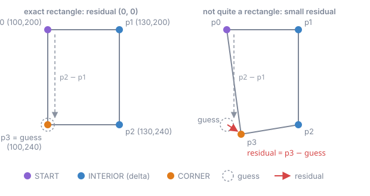
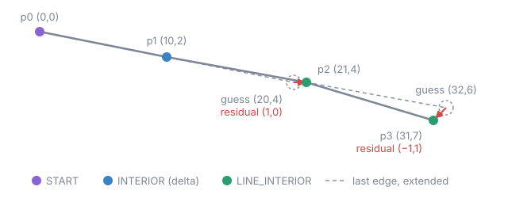

# 3. Prediction (S2)

## The idea

A vertex is rarely surprising. It lies close to the vertex drawn before it, and map geometry has shape:
buildings have right angles, roads keep their direction. Instead of storing a vertex, the encoder stores
how far it is from a guess, the residual `p[i] - guess(i)`. The guess may only use vertices the decoder
has already decoded, so the decoder can make the same guess and add the residual back. The better the
guess, the smaller and more repetitive the residuals, and the fewer bytes the compressor needs.

Different vertices deserve different guesses. Every predictor therefore gives each vertex a class, computed
from the topology alone: the first vertex of a ring, an ordinary vertex, the fourth corner of a rectangle.
The class picks the guess, and later decides which stream the residual goes to
([segmentation](06-segmentation.md)). Because both sides compute the classes, no label is ever written.

A vertex without a geometric guess is predicted by the previous vertex of the buffer, even across feature
boundaries. The chain of differences never restarts, so there are no absolute seed values in the payload.

## The guesses

### Delta

The guess is the previous vertex: `residual = p[i] - p[i-1]`. One class. This is what stock MLT does, and it
remains the best choice where there is no shape to exploit, as in point layers (`poi`, `housenumber`).

### Quad corner

Most buildings are rectangles, and a rectangle is fully determined by three of its corners. In a run of
exactly four vertices (a closed ring without its repeated closing vertex), the fourth corner is guessed to
complete the parallelogram of the first three: `guess = p0 + p2 - p1`. For an exact rectangle the
residual is `(0, 0)`.

Classes: `START` (first vertex of a run), `INTERIOR` (delta) and `CORNER` (the guessed fourth vertex).

```
vertices    p0=(100,200)  p1=(130,200)  p2=(130,240)  p3=(100,240)
class       START         INTERIOR      INTERIOR      CORNER
guess       previous      p0            p1            p0 + p2 - p1 = (100,240)
residual    p0 - previous (30,0)        (0,40)        (0,0)
```



### Line continuation

A road tends to continue in the direction it was going, with a similar step length. From the third vertex
of a line part on, the guess extends the last edge: `guess = p[i-1] + (p[i-1] - p[i-2])`. The residual is
then the change of the edge: how much the road bent and how much the step grew or shrank.

```
the first four vertices of a line part of six or more
vertices    p0=(0,0)  p1=(10,2)  p2=(21,4)        p3=(31,7)
guess       previous  p0         2·p1 - p0=(20,4)  2·p2 - p1=(32,6)
residual    p0        (10,2)     (1,0)             (-1,1)
```



Only line parts of at least six vertices are continued. On shorter parts and on polygon rings the
continuation guess measured worse than plain delta. Classes: `START`, `INTERIOR` (delta: the second vertex
of a part, short parts, rings and points) and `LINE_INTERIOR` (continued).

## From guesses to predictors

A predictor is one of the guesses above, optionally combined with two further ideas, each with a page of its
own:

- [frames](04-frames.md) rotate the residual into the direction of the wall or the road, so one of its
  two components is near zero;
- [shared references](05-shared-references.md) replace a vertex that an earlier ring or line already holds
  by a pointer to it.

Eight combinations are live. The code is the value in the payload header.

| code | predictor | guess | frame | shared references |
|---|---|---|---|---|
| 0 | `DELTA` | previous vertex | | |
| 1 | `QUAD_CORNER` | quad corner | | |
| 5 | `QUAD_CORNER_FRAME` | quad corner | ring frame | |
| 7 | `QUAD_CORNER_SHARED` | quad corner | | ring references |
| 8 | `QUAD_CORNER_SHARED_FRAME` | quad corner | ring frame | ring references |
| 2 | `LINE_CONTINUATION` | line continuation | | |
| 11 | `LINE_CONTINUATION_FRAME_HEADING` | line continuation | line frame and heading | |
| 13 | `LINE_CONTINUATION_SHARED_FRAME_HEADING` | line continuation | line frame and heading | line references |

The missing codes belonged to predictors the tile oracle never needed (for example a turn-angle predictor
and a corner guess on lines). They were retired, and their codes are not reused, so a payload never changes
meaning.

## Decoding

The decoder derives the classes from the topology, then walks the vertices in order: it takes the next
residual from the vertex's stream, undoes the frame rotation if the vertex is framed, and adds the guess,
computed from the vertices it has already decoded.

## What it is worth

Measured when the stage was added (Hilbert order, split varint, geometry buffers, gzip, against plain
delta + varint): `DELTA` -3,97%, `QUAD_CORNER` -4,79%, `LINE_CONTINUATION` -3,83%. Over the whole corpus
the corner guess wins only narrowly, because the best guess depends on the layer: corners for buildings,
continuation for roads, delta for points. That is the reason the predictor is chosen per layer
([compositions](01-composition.md)).

On their own layers the gains are larger, and grow with the ideas added on top:

| layer | predictor | gzip against plain delta + varint |
|---|---|---|
| `building` | `QUAD_CORNER` | -9,20% |
| `building` | `QUAD_CORNER_FRAME` | -12,69% |
| `transportation` | `LINE_CONTINUATION` | -5,23% |
| `transportation` | `LINE_CONTINUATION_FRAME_HEADING` | -6,89% |
| `transportation` | `LINE_CONTINUATION_SHARED_FRAME_HEADING`, chain order | -12,06% |

In the code (`encoder/prediction/Prediction.java`, `mechanism/SegmentQuadCorner.java`,
`mechanism/LineContinuation.java`) every guess implements one interface, `ClassifiedPredictor`: classify
the vertices, say which classes have a guess, compute the guess from the decoded prefix.

Further reading: [quad corner](../encoding/good/quad-corner.md),
[line continuation](../encoding/good/line-continuation.md); guesses that did not pay, such as
[delta of delta](../encoding/bad/delta-of-delta.md), [right-angle turns](../encoding/bad/right-angle-turn.md)
and [turn scalar](../encoding/bad/turn-scalar.md).
