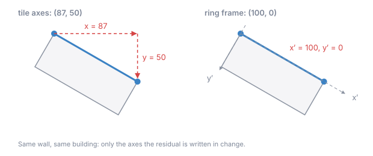
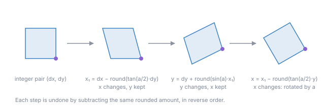

# 4. Frames: rotating the residual (S2)

## The idea

After prediction, a residual is still written in the tile's axes, as an `x` and a `y` difference. That is
wasteful for anything that is not axis-parallel. A building wall at 30° gives the delta `(87, 50)`: two
large numbers. Written in the wall's own direction, the same step is `(100, 0)`: one large number and a
zero.

The direction does not have to be transmitted. The decoder can predict it from what it has already
decoded: buildings along a street share their orientation, and after the Hilbert reorder the ring decoded
just before a new ring is usually its neighbour. A frame is this predicted direction, and the residual is
rotated into it before it is written.

Frames change no guess. They only change the coordinate system a residual is written in, so they combine
with the corner guess of the [prediction](03-prediction.md) page and with the
[shared references](05-shared-references.md). Line parts have no frame.

## The ring frame

Used by `QUAD_CORNER_PREVFRAME_FIRST_ONLY` (code 23) and `QUAD_CORNER_SHARED_RAW_PREVFRAME_FIRST_ONLY` (code 27,
with the shared references).

A frame is a wall direction modulo 90°, so walls at right angles share one frame. Each ring gets one vote,
from its first edge:

- the first plain-delta edge of a ring (vertex 1) is written in the frame of the ring decoded before it;
- that edge's own direction becomes the frame of every later edge of the ring (vertex 2, the second wall of
  a rectangle, is perpendicular to the first and lands on the same frame);
- the next ring starts from this first-edge frame.

The first ring of a buffer uses the tile's axes. A first edge of length zero has no direction and keeps the
previous ring's frame. The previous ring is the previous run of at least three vertices, so a hole follows
its outer ring.

The rotated vertices are the ones the corner guess leaves to plain delta: every edge of a ring except its
start and the predicted fourth corner.

```
wall at 30°     plain delta (87, 50)    in the ring frame (100, 0)
```



## Making a rotation lossless

A rotation of integers normally produces fractions, and rounding would lose information. The frames
instead rotate with three lifting shears. With `a` the rotation angle:

```
x1 = dx - round(tan(a/2) · dy)
y  = dy + round(sin(a) · x1)
x  = x1 - round(tan(a/2) · y)
```

Each line changes one coordinate by an amount computed from the other, so it can be undone exactly by
subtracting the same amount, in reverse order. The rotation is therefore a bijection on integer pairs: two
integers in, two integers out, nothing to round away and no extra stream.

The frame is an integer: 4096 frames over 90°. `tan(a/2)` and `sin(a)` are read from Q16 tables per
frame, and an edge's direction comes from one division and an integer `atan` table. The tables are built
once at start-up; a decode calls no `atan2`, `sin`, `cos` or `tan`, so encoder and decoder always agree on
the frame.



## Decoding

The decoder keeps one frame. At a ring start it takes the remembered frame; for each framed vertex it reads
the residual, undoes the shears with the current frame and adds the guess. After the first edge of a ring
it sets the frame from that edge's direction. Nothing about frames is read from the payload.

## What it is worth

`building`, Hilbert order, class streams, escape width, byte planes, against plain delta + varint:

| predictor | gzip | Brotli | zstd |
|---|---|---|---|
| `QUAD_CORNER` | -9,20% | -13,60% | -10,41% |
| `QUAD_CORNER_PREVFRAME_FIRST_ONLY` | -12,38% | -19,47% | -15,03% |

On whole tiles (Munich, the five ring layers of the per-layer default switched) the shared variant
gains 110.174 bytes over the references without a frame and decodes at 3,83 to 3,87 times stock instead of
3,20 to 3,21 (measured with the earlier entry index, codes 25 and 7).

In the code: `research-rust/mlt-pipeline/src/frame.rs` (frame, tables, shears) and the `FramePass` in
`research-rust/mlt-pipeline/src/predict.rs` (which vertices are framed).

Further reading: [ring frame](../encoding/good/ring-frame-prior.md),
[previous-ring frame results](https://github.com/Turtelll/Thesis/blob/main/research-java/docs/results/previous-frame.md),
[frame decode time](https://github.com/Turtelll/Thesis/blob/main/research-java/docs/results/frame-decode-time.md).
