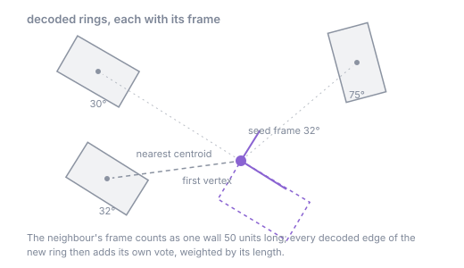
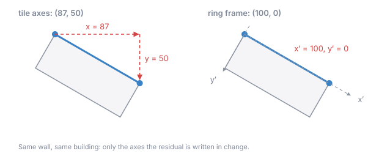
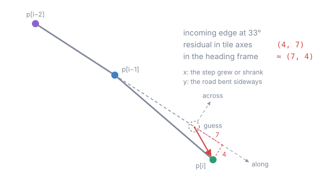
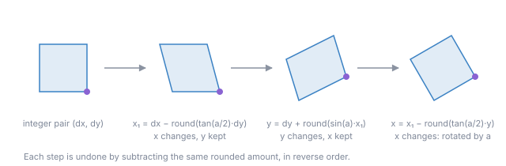

# 4. Frames: rotating the residual (S2)

## The idea

After prediction, a residual is still written in the tile's axes, as an `x` and a `y` difference. That is
wasteful for anything that is not axis-parallel. A building wall at 30° gives the delta `(87, 50)`: two
large numbers. Written in the wall's own direction, the same step is `(100, 0)`: one large number and a
zero.

The direction does not have to be transmitted. The decoder can predict it from what it has already
decoded: buildings along a street share their orientation, so the nearest decoded building predicts the
next one to within about a degree (median 1,1° on `building`), and a road's next step points roughly where
its last edge pointed. A frame is this predicted direction, and the residual is rotated into it before it is
written.

Frames change no guess. They only change the coordinate system a residual is written in, so they combine
with every guess of the [prediction](03-prediction.md) page and with the
[shared references](05-shared-references.md).

## The encodings

### Ring frame

Used by `QUAD_CORNER_FRAME` and `QUAD_CORNER_SHARED_FRAME`.

The frame of a ring is its dominant wall direction modulo 90°: every edge votes with its length, and the
angles are multiplied by four so that walls at right angles vote for the same frame.

When a new ring starts, the frame is seeded with the frame of the decoded ring whose centroid is nearest the
new ring's first vertex. That neighbour counts as much as a wall 50 units long. As each edge of the new ring
is decoded, it adds its own vote, so a long ring soon follows its own walls rather than its neighbour's.



The rotated vertices are the ones the corner guess leaves to plain delta: every edge of a ring except its
start and the predicted fourth corner.

```
wall at 30°     plain delta (87, 50)    in the ring frame (100, 0)
```



### Line frame

Part of `LINE_CONTINUATION_FRAME_HEADING`. The same frame applied to the plain-delta edges of line parts:
the second vertex of each part, and every vertex of a part too short to be continued. Lines and rings share
one neighbour search, so a road can take its frame from the building beside it.

### Heading

Also part of `LINE_CONTINUATION_FRAME_HEADING`. A continued road vertex already has a residual that means
"how the road changed". Rotated into the direction of the incoming edge `p[i-1] - p[i-2]`, its `x` becomes
the change along the road (the step got longer or shorter) and its `y` the sideways bend. The two behave
differently and are each usually small. The heading is the full direction of the edge, not taken modulo 90°.

```
incoming edge at 33°, continuation residual (4, 7)    in the heading frame about (7, 4)
```



## Making a rotation lossless

A rotation of integers normally produces fractions, and rounding would lose information. The frames
instead rotate with three lifting shears. With `a` the rotation angle:

```
x1 = dx - round(tan(a/2) · dy)
y  = dy + round(sin(a) · x1)
x  = x1 - round(tan(a/2) · y)
```

Each line changes one coordinate by an amount computed from the other, so it can be undone exactly by
subtracting the same amount, in reverse order. The rotation is therefore a bijection on integer pairs: two
integers in, two integers out, nothing to round away and no extra stream. All angles are computed with
`StrictMath` and IEEE arithmetic, which give identical bits on every machine, so encoder and decoder
always agree on the frame.



## Decoding

The decoder keeps the same state as the encoder: a grid of decoded rings and line parts with their frames
and centroids. At a ring start it looks up the nearest neighbour; for each framed vertex it reads the
residual, undoes the shears with the current frame, adds the guess, and lets the decoded edge vote for the
frame. For a continued line vertex it computes the direction of the decoded edge before it and undoes the
heading rotation. Nothing about frames is read from the payload.

## What it is worth

On the layers they were built for (Hilbert order, class streams, escape bytes, against plain
delta + varint):

| layer | without frame | with frame | gzip | Brotli 11 |
|---|---|---|---|---|
| `building` | `QUAD_CORNER` | `QUAD_CORNER_FRAME` | -9,20% to -12,69% | -13,61% to -19,80% |
| `transportation` | `LINE_CONTINUATION` | `LINE_CONTINUATION_FRAME_HEADING` | -5,23% to -6,89% | -9,57% to -11,55% |

On `transportation` the line frame alone gives -6,20% and the heading alone -5,92%; together they add up.
The smaller polygon layers gain less: `landcover` -4,70% to -5,15%, `landuse` -4,70% to -5,72%.

The price is decode time. The angle computations (`atan2`) make these predictors 5,86x slower to decode than
stock FastPFOR on `building` and 4,92x on `transportation`. The thesis target is compressed size per tile, so
this cost is reported, not optimised.

In the code: `encoder/prediction/mechanism/FramePrior.java` (frame, neighbour grid, shears) and the
`FramedPredictor` in `encoder/prediction/Prediction.java` (which vertices are framed).

Further reading: [ring frame](../encoding/good/ring-frame-prior.md),
[line frame](../encoding/good/line-frame-prior.md), [heading](../encoding/good/line-heading-frame.md),
[orientation prior results](https://github.com/Turtelll/Thesis/blob/main/research-java/docs/results/orientation-prior.md).
