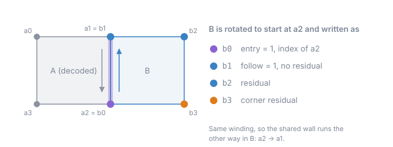
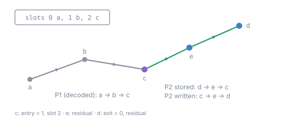
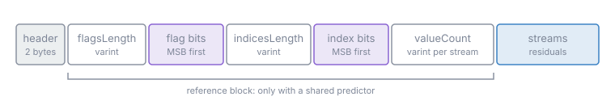

# 5. Shared references (S2)

## The idea

Map geometry repeats itself exactly. Row houses share walls, landcover and landuse polygons share their
borders, and roads meet at junctions. At z14, 23,55% of the `building` vertices sit at a position another
ring also holds; in `transportation`, 38,7% of the vertices sit at a position that occurs more than once,
and 74% of those are the start or end of a line part.

Prediction cannot see these repeats, because the earlier copy is usually far back in the buffer. A
reference can: instead of a residual, the encoder writes "this vertex is the one at that earlier position".
A reference costs a flag bit and a short index, which is far less than a residual, and a vertex that is
referenced still counts as decoded, so guesses and frames after it work as before.

References are added on top of a guess. Each shared predictor is the plain predictor of the
[prediction](03-prediction.md) page plus references: `QUAD_CORNER_SHARED_RAW` (code 26) and
`QUAD_CORNER_SHARED_RAW_PREVFRAME_FIRST_ONLY` (code 27, with the [ring frame](04-frames.md)) for rings, `LINE_CONTINUATION_SHARED_RAW` (code 28) for lines.

## The encodings

### Rings: a window of neighbours, then a walk along the wall

Rings refer to earlier rings (`research-rust/mlt-pipeline/src/refs.rs`, `encoder/reference/RingReferences.java`).
Two neighbouring rings with the same winding walk their shared wall in opposite directions, which the encoding
uses. There are two kinds of reference: an **entry** into a shared wall, which needs an address, and a **follow**
step along it, which needs only one bit.

1. Each ring is rotated (its winding kept) to start where its longest shared stretch begins. This is a
   free choice of the encoder and is not written.
2. Entry flag, once per ring: one bit saying whether the ring's first vertex is one of the vertices of the
   **window**, the last four rings. On a hit, the **entry index** replaces the start residual: the vertex's
   slot among the window's vertices, counted from the newest ring back, in `ceil(log2 windowVertices)` bits.
   A position that appears twice in the window (a corner both neighbours share) takes the first slot.
3. Follow flag, after every vertex whose position an earlier ring holds (any earlier ring of the buffer, not
   only the window): one bit saying whether the next vertex is that ring's previous vertex. On a hit, no
   residual at all.

```
window (newest first)   ring A: a0 a1 a2 a3    ring Z: z0 .. z5        -> 10 slots, 4 bits
ring B                  shares the wall a2-a1, rotated to start at a2: b0=a2 b1=a1 b2 b3
B is written as         entry=1, slot 2 (a2) | follow=1 | residual of b2 | corner residual of b3
```



### Lines: a dictionary of earlier positions

Lines refer to the vertices of the earlier line parts in the buffer (`research-rust/mlt-pipeline/src/refs.rs`,
`encoder/reference/LineReferences.java`). Junctions are at the ends of parts, so only the ends are checked:

1. At every part start and every part end, a flag bit; on a hit the index replaces the residual: the vertex's
   slot among the earlier line parts' vertices, in buffer order, in `ceil(log2 slots)` bits. A position that
   several earlier parts hold (a junction) takes the first slot. Rings and points in the buffer take no slot.
2. A part whose end is in the dictionary and whose start is not is reversed, so the junction comes first.
   This is not written, and it is the one place where the pipeline changes line direction.

```
part P1   a b c          slots 0 a, 1 b, 2 c
part P2   d e c          reversed to c e d: entry=1, slot 2 (c) | residual of e | exit=0, residual of d
```



Rings and points in a line layer keep their plain residuals.

### Fallback

The encoder writes every buffer both with and without references and keeps the smaller one. Without a
gain, the header names the plain predictor (`QUAD_CORNER`, `QUAD_CORNER_PREVFRAME_FIRST_ONLY`,
`LINE_CONTINUATION`). A layer without shared vertices therefore pays nothing, and no mode byte
is needed.

### Residuals instead of positions

The same idea one stage later was tried and removed: share the pair that is written after prediction and the
frame, instead of the vertex, by a flag and a 4-bit index into the last 16 pairs of the stream (or by whole
repeated runs). In the tile oracle on `building` it saved 0,39% gzip and nothing under Brotli, so it is not part
of the pipeline: [shared residual references](../encoding/bad/shared-residual-references.md).

## What the payload carries

References are the one place where the decoder cannot derive everything from the topology: which vertices
are referenced, and so how many residuals each stream holds, is only known while decoding. A block between
the header and the streams carries it:

```
varint flagsLength | flag bits | varint indicesLength | index bits | varint valueCount per stream
```



Flags and indices are bit-packed, most significant bit first.

## Decoding

The decoder reads the flag and index bits and the value counts, then walks the vertices. Where a flag is
due, it reads one; on a hit it emits the referenced position, otherwise it decodes the residual of the
plain predictor. Rotated rings and reversed parts are emitted as they are.

For rings it keeps two things up to date, once per completed ring:

- **the window**, the bounds of the last four rings. An entry index is resolved by walking at most four ring
  lengths back from the newest ring: no table.
- **a position table** of every earlier ring vertex (position to the latest vertex holding it). It tells the
  decoder whether a follow flag is due after a vertex, and from which ring to take the previous vertex.

The position table is what the references cost at decode time: one lookup and one insert per ring vertex,
although only 7,8% of the ring vertices of the corpus are references. It cannot be limited to the window:
55% of the follow references reach further back than four rings.

Lines have no follow flag, so they need no position table at all: the decoder keeps the vertex index of every
slot, appended once per completed part, and an index is one array read.

## The index: slots instead of distinct positions

The entry index used to count the window's **distinct** positions (codes 7 and 25, which the Java research
pipeline still has). That index is a little narrower where neighbours share corners, but the decoder can only
read it after deduplicating the window: a hash of the window's four rings for every entry reference, which was
25% of the decode cost of the references. Counting raw slots needs no deduplication, so the decoder resolves
the index by walking ring lengths.

| | distinct positions (7, 25) | window slots (26, 27) |
|---|---|---|
| gzip, corpus (per-layer default compositions) | | +0,009% |
| decode cost of the references (codec alone, over the same predictor without them) | 1,02 / 0,92 × `DELTA` | 0,67 / 0,58 × `DELTA` (-35% / -37%) |
| Munich, tile oracle, whole tiles | 15.172.888 B, 2,46 × stock | 15.173.753 B (+0,006%), 2,28 × stock (-7%) |

The index only gets wider where duplicates in the window push its size past a power of two, on 69.512 entry
references of the corpus. The rotation, the flags, the follow references and the residuals are unchanged.

The line references made the same change (code 12 to 28): their index counted the earlier parts' distinct
positions, which the decoder could only read by keeping a position table of every line vertex (a lookup and an
insert per vertex). Counting raw slots removes the table. The reversal, the flags and the residuals are unchanged.

| | distinct positions (12) | raw slots (28) |
|---|---|---|
| Munich, per-layer default, whole tiles | 15.836.613 B, 2,47 to 2,58 × stock | 15.843.951 B (+0,046%), 2,37 to 2,48 × stock (-4%) |
| decode cost of the references on `transportation` (codec alone, over `LINE_CONTINUATION`) | 17,4 / 16,3 ns per vertex | 10,0 / 9,4 (-42%) |
| Munich, tile oracle, whole tiles | 15.173.753 B, 2,31 to 2,36 × stock | 15.180.223 B (+0,043%), 2,22 to 2,27 × stock (-3%) |

The line index costs more than the ring one: every part start and end can be a reference, and junction
positions repeat in many earlier parts, so the slots outgrow the distinct positions faster.

## What it is worth

- Rings: in the earlier pipeline, adding references to `QUAD_CORNER` saved 2,22 points of gzip on the whole
  corpus; on `building` today they add 2,4 to 2,5 points (gzip, with and without the ring frame). `QUAD_CORNER_SHARED_RAW_PREVFRAME_FIRST_ONLY` is
  the default of `building`, `landcover`, `landuse`, `water` and `aeroway`, `QUAD_CORNER_SHARED_RAW` that of `park`.
- Decode: in the codec alone a ring vertex under `QUAD_CORNER_SHARED_RAW` costs 1,60 × a `DELTA` vertex, against 0,96 × for
  plain `QUAD_CORNER`; with the frame (`QUAD_CORNER_SHARED_RAW_PREVFRAME_FIRST_ONLY`) 2,40 ×.
- Lines: on `transportation` (gzip, against plain delta + varint, measured on the earlier line-frame
  predictor), references added 5,8 points in stored order and 2,9 with the chain order, which places
  connected parts next to each other. `LINE_CONTINUATION_SHARED_RAW` is today the default of `transportation`,
  `transportation_name`, `waterway` and `boundary`.

Further reading: [shared ring vertices](../encoding/good/shared-ring-vertices.md),
[line dictionary](../encoding/good/shared-line-vertices.md),
[shared vertices](https://github.com/Turtelll/Thesis/blob/main/research-java/docs/results/shared-vertices.md),
[shared-reference decode time](https://github.com/Turtelll/Thesis/blob/main/research-java/docs/results/shared-decode-time.md),
[line shared vertices](https://github.com/Turtelll/Thesis/blob/main/research-java/docs/results/line-shared-vertices.md).
