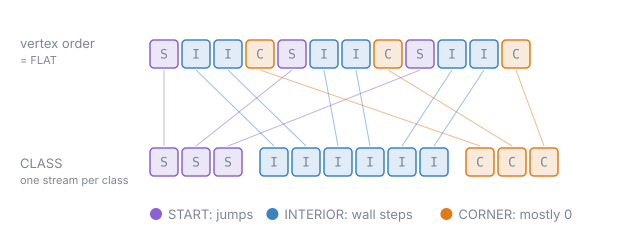

# 6. Segmentation (S3)

## The idea

A predictor produces residuals of very different kinds. The first vertex of a ring carries a jump of
hundreds of units, an ordinary wall a medium step, and a predicted building corner is almost always
`(0, 0)`. Written in vertex order, these kinds alternate, and the compressor sees a mix with no clear
statistics. Written into separate streams, each stream is homogeneous: a stream of corners is a long run of
zeros, a stream of ring starts holds only jumps.

The split costs nothing, because the class of every vertex is known to both sides from the topology
streams, which the decoder reads before the vertex buffer. Neither the class labels nor the stream lengths
are written. Segmentation moves residuals around; it does not change any of them.

## The encodings

Two options are in use (`encoder/segmentation/Segmentation.java`):

- `FLAT`: one stream, in vertex order.
- `CLASS`: one stream per vertex class, in a fixed order per predictor. For the corner predictors this is
  `START, INTERIOR, CORNER`; for the line predictors `START, INTERIOR, LINE_INTERIOR`.

```
vertex order    S I I C S I I C S I I C ...
FLAT            S I I C S I I C S I I C ...
CLASS           S S S ... | I I I I I I ... | C C C ...
```



Each stream holds two values, `x` and `y`, per vertex assigned to it. Empty streams are skipped. For
`DELTA` there is only one class, so both options give the same bytes.

Two further splits, by role (jump, edge, body) and by role and class, were measured and lost: they cut the
data into more pieces than the extra homogeneity pays for.

## Decoding

The decoder computes the class of every vertex and so the length of every stream, decodes each stream
(the [byte](07-byte-width.md) and [transpose](08-transpose.md) stages), then walks the vertices in order,
each taking the next value from its own stream. With [shared references](05-shared-references.md), the
referenced vertices leave their streams, which is why that block writes the stream lengths explicitly.

## What it is worth

Measured when the stage was added (gzip, against plain delta + varint): one flat stream -4,65%, class
streams -5,86%, so about 1,2 points, mostly on `building`.

The class streams do not win everywhere. Small buffers and line layers often compress better as one
stream, and the tile oracle picks `FLAT` on 56% of the layers. In the search over all compositions,
taking `CLASS` away costs 1,2% and taking `FLAT` away 0,1%, so both stay.

Further reading: [class streams](../encoding/good/class-streams.md),
[role streams](../encoding/bad/role-streams.md),
[S3 results](https://github.com/Turtelll/Thesis/blob/main/research-java/docs/results/openzl-pipeline.md#s3-segmentation).
