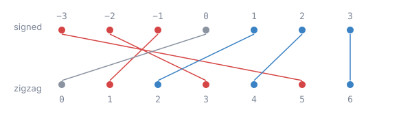
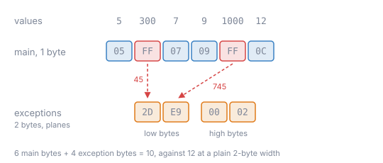

# 7. From residuals to bytes: zigzag and byte width (S4, S6)

## The idea

After prediction the streams hold signed integers, and most of them are small: 87% of the residuals fit in
one byte, and none needs more than two. Turning them into bytes takes two decisions. First, the sign has to
be folded in so that small negative values stay small. Second, the few large values have to be paid for
without spoiling the many small ones, because a compressor does best on a long run of uniform single bytes.

## Zigzag (S4)

Zigzag interleaves negative and positive values, so the magnitude decides the size, not the sign:

```
zigzag(n) = (n << 1) ^ (n >> 31)

 0 → 0   -1 → 1   1 → 2   -2 → 3   2 → 4   ...   100 → 200   -30 → 59
```



It is the only residual map. The alternative, subtracting each stream's minimum, made the raw streams 58%
larger and was worse on every layer (+9,51% gzip against -5,86% for zigzag), so it was removed.

## Byte width (S6): escape width

Escape writes every value in one byte and moves the large ones out of the way. A value of 255 or more is
replaced by the marker `0xFF` in the main stream, and `value - 255` is stored in a separate exception list
after it. One descriptor byte in front says how wide the main values and the exceptions are:

```
descriptor   bits 0-1  main width (0 = 1 byte, 1 = 2 bytes, 2 = 4 bytes)
             bit  2    escape flag
             bits 3-4  exception width (same codes)

values       5   300   7   9   1000   12
main         05  FF    07  09  FF     0C
exceptions   45, 745 at 2 bytes, as byte planes: 2D E9 | 00 02
```



Here six values plus two 2-byte exceptions take 10 bytes, against 12 at a plain 2-byte width.

The escape is only used when it is smaller than writing every value at the width of the largest one;
otherwise the stream is written at that plain fixed width. No count is written: the number of values
follows from the topology, the number of exceptions from the markers.

Two other widths were measured and lost: the narrowest fixed width holding the stream's maximum
(+12,27% gzip), and four bytes per value (+35,18%).

## Decoding

Read the descriptor and the main bytes, count the `0xFF` markers, read that many exceptions, and replace
each marker by `255 + exception`. Then undo zigzag with `(v >>> 1) ^ -(v & 1)`.

## What it is worth

Measured when the stage was added (gzip, against plain delta + varint): plain varint -4,55%, escape -5,90%.
Escape is a fixed width, which is what the [byte planes](08-transpose.md) need; it is the only byte width
of the composition grid.

In the code: `research-rust/mlt-pipeline/src/stream.rs`.

Further reading: [escape width](../encoding/good/escape-byte-width.md),
[fixed byte widths](../encoding/bad/fixed-byte-width.md),
[S6 results](https://github.com/Turtelll/Thesis/blob/main/research-java/docs/results/openzl-pipeline.md#s6-byte-width).
